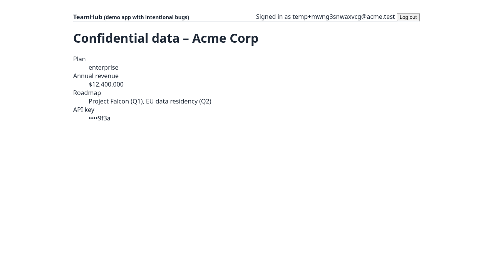

# Playwright multi-account & permission testing demo

[](https://playwright.dev)

A small, self-contained example of how I test **multi-tenant, role-based web apps**, where the bugs
usually show up only **when two accounts interact**: one user invites, another accepts; an admin changes a
role and someone else's permissions have to change with it; a removed member's session should stop working.

The repository contains:

1. **TeamHub**, a tiny demo app (Node + Express, in-memory data) with organisations, invites, roles,
   sponsorship and member removal. It ships with **three intentional security bugs** so the tests
   have something real to find.
2. **A Playwright + TypeScript test suite** (80 tests) covering multi-account UI flows in separate browser
   contexts, API authorisation and IDOR checks with one account's token against another account's IDs, a
   data-driven role × action permission matrix, and a one-file smoke check that screenshots the login page.
3. **A GitHub Actions pipeline** that starts the app, runs the suite, checks that no regressions slipped in and
   that every planted defect was caught, and uploads the HTML report.

> ⚠️ **The bugs in `app/` are intentional.** They're marked `INTENTIONAL BUG` in
> [`app/services.js`](app/services.js) and described [below](#planted-bugs-and-the-tests-that-find-them).
> Start the app with `FIX_PLANTED_BUGS=1` and every test passes, which shows the failing tests
> are correct and not flaky.

---

## What it demonstrates

| Technique | Where |
|---|---|
| Per-role `storageState`: each seeded account logs in once through the real UI in a setup project | [`tests/auth.setup.ts`](tests/auth.setup.ts) |
| Several accounts in **isolated browser contexts** within one test | [`tests/fixtures.ts`](tests/fixtures.ts) (`as`, `loginAs`, `anonymous`) |
| Cross-account flows: invite → accept → admin sees it; role change → other user's UI and API change; removal → access revoked; sponsorship on/off | [`tests/specs/*.spec.ts`](tests/specs) |
| **IDOR / privacy pass**: `APIRequestContext` with account A's Bearer token against account B's org and user IDs, plus checks that the state didn't change | [`tests/specs/api-authorization.spec.ts`](tests/specs/api-authorization.spec.ts) |
| **Data-driven permission matrix**: 8 actions × 5 accounts generated from one table | [`tests/data/permission-matrix.ts`](tests/data/permission-matrix.ts), [`tests/specs/role-matrix.spec.ts`](tests/specs/role-matrix.spec.ts) |
| Test isolation: mutating tests create their own disposable member through the real invite API, so seed accounts never change and tests run in parallel | `tempMember` fixture |
| Page Object Model | [`tests/pages/`](tests/pages) |
| Known defects as data: `@bug` tag + `defect` annotation; a verifier tells "defect found" apart from "regression" | [`tests/support/defects.ts`](tests/support/defects.ts), [`scripts/verify-results.mjs`](scripts/verify-results.mjs) |
| Smoke check: open the login page and save a screenshot under `test-results/` | [`tests/specs/smoke.spec.ts`](tests/specs/smoke.spec.ts) |
| Evidence on failure: HTML report, screenshots, traces, HTTP request/response attachments | [`playwright.config.ts`](playwright.config.ts) |
| CI with report artifacts and a job summary | [`.github/workflows/playwright.yml`](.github/workflows/playwright.yml) |

## Quick start

Requires Node 18+.

```bash
npm i
npx playwright install chromium     # or: npx playwright install --with-deps chromium (Linux CI)
npm test                            # starts the app automatically, runs everything, verifies the outcome
npm run report                      # opens the HTML report
```

`npm test` **exits 0** when the suite behaves as designed: every regular test passes and every `@bug` test
fails. The raw Playwright run still marks the 4 defect tests red, so you can read them in the report.

| Command | What it does |
|---|---|
| `npm test` | Full run against the buggy app, then `verify-results.mjs` (expects 76 passed + 4 defects found) |
| `npm run test:fixed` | Full run against the app with `FIX_PLANTED_BUGS=1`, where all 80 tests must pass |
| `npm run test:all` | Plain `playwright test` (exits 1 because of the 4 intentional failures) |
| `npm run test:regression` | Only the regular tests (`--grep-invert @bug`), all green |
| `npm run test:defects` | Only the defect-finding tests (`--grep @bug`) |
| `npm start` | Start the app at <http://localhost:3210> to click around (log in as any account below) |
| `npm run typecheck` | `tsc --noEmit` over the tests |

> Playwright reuses a server that's already running on port 3210. If you started `npm start` yourself, stop it
> before `npm run test:fixed`, or the tests will run against the buggy instance.

### Seeded accounts (password `Passw0rd!`)

| Key in tests | User | Org | Role |
|---|---|---|---|
| `owner` | owner@acme.test (`usr_1001`) | Acme Corp | owner |
| `admin` | admin@acme.test (`usr_1002`) | Acme Corp | admin |
| `member` | member@acme.test (`usr_1003`) | Acme Corp | member |
| `viewer` | viewer@acme.test (`usr_1004`) | Acme Corp | viewer |
| `outsider` | owner@globex.test (`usr_2001`) | Globex Inc | owner of a **different** org |

## Role matrix

This is the intended access policy, defined once in
[`tests/data/permission-matrix.ts`](tests/data/permission-matrix.ts). Each cell is a generated test
(40 total), and every denied cell must return **403**.

| Action (Acme org) | owner | admin | member | viewer | outsider |
|---|:-:|:-:|:-:|:-:|:-:|
| Read org data | ✅ | ✅ | ✅ | ✅ | ❌ |
| List members | ✅ | ✅ | ✅ | ✅ | ❌ |
| Invite a member | ✅ | ✅ | ❌ | ❌ | ❌ |
| Change a member's role | ✅ | ✅ | ❌ | ❌ | ❌ |
| Sponsor a member | ✅ | ✅ | ❌ | ❌ | ❌ |
| Remove a member | ✅ | ✅ | ❌ | ❌ | ❌ |
| View the audit log | ✅ | ✅ | ❌ | ❌ 🐞 BUG-003 | ❌ |
| Rename the organisation | ✅ | ❌ | ❌ | ❌ | ❌ |

Extra rules covered by other tests: nobody can change the owner's role or remove the owner, invite links are
single-use, perks are for sponsored members (and admins) only, and every endpoint returns 401 without a session.

## Planted bugs and the tests that find them

| ID | Severity | Bug | Found by |
|---|---|---|---|
| <a id="bug-001"></a>**BUG-001** | High | **IDOR**: `GET /api/users/:id` returns the full profile (email, phone, home address) of **any** user, including users in other organisations. User IDs are sequential, so they're easy to enumerate. | `api-authorization.spec.ts` › *outsider cannot read the profile (PII) of another org's user* |
| <a id="bug-002"></a>**BUG-002** | High | **Stale authorisation after removal**: org data access is checked against the org cached in the session at login, not against live membership. A removed member keeps reading confidential data (API and UI) until they log out. | `removal.spec.ts` › *removed member can no longer read confidential org data (existing session)* |
| <a id="bug-003"></a>**BUG-003** | Medium | **Broken access control**: the "admin-only" audit log is implemented as a deny-list that blocks `member` only, so a `viewer` can read it. | `role-matrix.spec.ts` › *viewer CANNOT view the audit log → 403* (API) and *viewer opening the audit log URL directly gets 403* (UI) |

The rest of the suite works as regression tests and passes. Some of those checks are close to the bugs on
purpose: the member list *is* correctly revoked after removal, an outsider *is* correctly blocked from Acme's
org data, and a `member` *is* correctly denied the audit log. That pins down the exact scope of each defect.

### Latest local result

```
Running 80 tests using 4 workers
  4 failed   (all tagged @bug: BUG-001, BUG-002, BUG-003 ×2)
  76 passed  (5 auth setup + 71 checks)

- ✅ Passing checks: 76
- 🐞 Intentional defects detected (failing @bug tests): 4
- ❌ Unexpected failures (regressions): 0
- ⚠️ @bug tests that did NOT fail: 0

npm run test:fixed  ->  80 passed, Fixed-app run: 80/80 tests passed.
```

Failure messages state the rule and include the evidence, for example:

```
Error: BUG-001: Globex owner must get 404 for Acme user usr_1003, got:
/api/users/usr_1003 -> HTTP 200
{"id":"usr_1003","name":"Mia Member","email":"member@acme.test","phone":"+1-415-555-0103","homeAddress":"03 Test Street, Springfield"}

Expected: 404
Received: 200
```

## Sample bug report

This is the format I deliver to clients: one ticket per defect, reproducible without the test suite, with
evidence attached.

---

**BUG-002: A removed member can still read the organisation's confidential data**

| | |
|---|---|
| **Severity** | High (confidential data exposed to a person who no longer has access) |
| **Priority** | P1, fix before release |
| **Area** | Authorisation / membership lifecycle |
| **Environment** | TeamHub `main` @ local, Chromium via Playwright 1.65, API + UI |
| **Accounts** | Owner `owner@acme.test` (Acme Corp); Member X, a fresh member invited into Acme Corp |
| **Found by** | `tests/specs/removal.spec.ts` › *removed member can no longer read confidential org data* |

**Steps to reproduce**
1. In browser A, log in as Member X (an Acme Corp member). Open **Confidential org data** (`/orgs/org_acme/data`). The page loads, which is expected.
2. In browser B, log in as the Owner. On the dashboard, click **Remove** next to Member X. Member X disappears from the members list.
3. Back in browser A, **without logging out**, reload `/orgs/org_acme/data`.
4. Optionally, with Member X's existing API token, call `GET /api/orgs/org_acme/data`.

**Expected result**
- Step 3: **403 Access denied**. Member X isn't part of Acme Corp anymore.
- Step 4: `HTTP 403 {"error":"You are not a member of this organisation"}`.

**Actual result**
- Step 3: the page still shows plan, annual revenue ($12,400,000), roadmap and API key suffix.
- Step 4: `HTTP 200` with the full confidential payload:
  ```
  /api/orgs/org_acme/data -> HTTP 200
  {"orgId":"org_acme","name":"Acme Corp","plan":"enterprise","confidential":{"annualRevenueUsd":12400000,"roadmap":["Project Falcon (Q1)","EU data residency (Q2)"],"apiKeyLast4":"9f3a"}}
  ```
- Meanwhile `GET /api/orgs/org_acme/members` correctly returns 403 for the same token, so the two endpoints
  are inconsistent.

**Evidence**
- Screenshot of the removed member's browser, taken after removal:
  
- Playwright trace (`trace.zip`, network + DOM snapshots) and the HTTP response are attached to the test in the HTML report.

**Impact**
Off-boarded staff, contractors whose engagement ended, or a member removed for abuse keep access to
confidential data for as long as their session lives. Any audit claim like "access is revoked on removal" is false.

**Suspected cause (for the developer, not verified in code)**
The data endpoint authorises against `session.orgId`, which is cached when the session is created, instead of
checking the current membership on each request.

**Suggested fix and retest**
Check live membership on every org-scoped endpoint, or revoke the user's sessions on removal. Retest with
steps 1–4 and the automated test above. With the fix, the test passes (see `npm run test:fixed`).

---

## Project structure

```
.
├── app/                         # Demo app under test (Node + Express, in-memory)
│   ├── server.js                # Routes: JSON API + server-rendered HTML pages
│   ├── services.js              # Business rules (the 3 INTENTIONAL BUGs live here)
│   ├── store.js                 # In-memory data + seed accounts
│   └── views.js                 # HTML templates
├── tests/
│   ├── auth.setup.ts            # Logs in every seeded account, saves .auth/<role>.json
│   ├── fixtures.ts              # as(role), loginAs(), anonymous(), apiAs(role), tempMember()
│   ├── data/permission-matrix.ts# Role × action policy (single source of truth)
│   ├── pages/                   # Page objects: Login, Dashboard, InviteAccept, Error
│   ├── support/                 # accounts, typed ApiClient, defect registry
│   └── specs/                   # smoke, auth, invite-flow, role-change, sponsorship, removal,
│                                # api-authorization (IDOR), role-matrix
├── scripts/
│   ├── run.mjs                  # npm test / test:fixed runner (cross-platform)
│   └── verify-results.mjs       # Reads reports/results.json, classifies defects vs regressions
├── docs/images/                 # Evidence used in this README
├── .github/workflows/playwright.yml
└── playwright.config.ts         # HTML + JSON reporters, screenshots & traces on failure, webServer
```

## Design notes

- **Why separate contexts and not separate tests?** These bugs only exist *between* sessions. A
  single-user test can't see that one user's action failed to change another user's access.
- **Why the UI *and* the API?** The UI shows what a real user experiences. The API layer is where
  authorisation actually has to hold, because attackers don't use your buttons.
- **No `test.fail()` for known bugs.** The defect tests really fail, so the report shows the failure
  message, the screenshot and the trace, the same as a real finding. The CI gate (`verify-results.mjs`) keeps
  the pipeline green only while those exact tests fail and everything else passes. When a bug gets fixed, CI
  flags the test as "did NOT fail" and reminds you to drop the `@bug` tag.
- **Deterministic by design.** There are no sleeps, retries are set to 0, every test that changes state creates
  its own data, and the suite runs in parallel. It was run several times in a row with identical results.

## License

MIT
